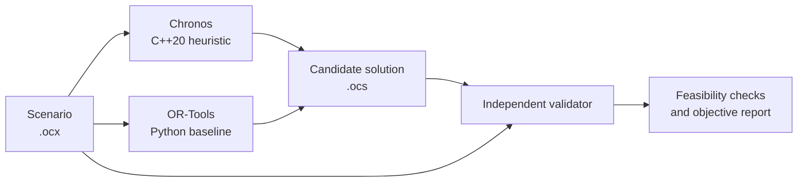

# OptiCore: Vehicle Routing Optimization in C++20

[](https://en.cppreference.com/w/cpp/20)
[](https://cmake.org/)
[](LICENSE)

> OptiCore is a C++20 vehicle routing solver for problems with vehicle capacity and customer time windows. It includes a custom CPU heuristic, a route simulator, an independent solution validator, and a Google OR-Tools baseline for comparison.

---

## Architecture Overview



The simulator is the canonical source for route schedules. The validator checks solutions against the input scenario and recalculates reported values.

---

## Benchmark Results

Verification run `run-20261103-091855`. All solutions passed the OptiCore validator. OR-Tools ran to its configured time limit.

| Instance | Customers | Chronos cost | OR-Tools cost | Chronos time | OR-Tools time |
|:--|--:|--:|--:|--:|--:|
| tiny-8 | 8 | 412.420 | 412.420 | 0.063 s | 5.153 s |
| small-20 | 20 | 631.426 | 631.426 | 0.191 s | 15.153 s |
| medium-50 | 50 | 1127.684 | 1124.330 | 1.073 s | 30.153 s |

On these runs, Chronos matched the baseline cost for tiny-8 and small-20. For medium-50, its cost was 0.298% higher. Measurements were collected on an Intel Core i7-13620H laptop with 16 GB RAM. They describe these instances and solver settings, not general performance guarantees.

---

## Core Capabilities

- **Route construction:** Clarke-Wright savings and feasible insertion for unassigned customers.
- **Local search:** Relocate, swap, 2-Opt, and seeded iterated local search.
- **Schedule simulation:** Computes travel, waiting, service, time-window lateness, and depot return timing.
- **Independent validation:** Checks route structure, customer coverage, vehicle capacity, shift duration, time windows, and reported costs.
- **Reference comparison:** Python runner using Google OR-Tools, with output validated by the C++ CLI.
- **Reproducible experiments:** Fixed benchmark scenarios, a runner, and recorded results.

The CUDA document describes a possible batch-evaluation design; CUDA execution is not included in the current build. Road-network ingestion, map visualization, and service APIs remain future work.

---

## Project Structure

```text
opticore/
|-- core/                 # C++ types, file formats, scheduler, objective, validator
|-- solvers/
|   |-- cpu/              # Chronos solver
|   `-- baseline/         # Google OR-Tools runner
|-- simulation/           # Synthetic scenario generator
|-- benchmarks/           # Fixed instances, harness, and recorded results
|-- examples/             # Sample scenario and solutions
|-- tests/                # C++ and Python tests
|-- docs/                 # Architecture, algorithms, experiments, and design notes
|-- tools/                # Command-line interface
|-- CMakeLists.txt
`-- LICENSE
```

---

## Quickstart

### Requirements

- CMake 3.20 or newer
- A C++20 compiler
- Python and Google OR-Tools for baseline comparison and cross-language tests

### Build

```bash
cmake -S . -B build -DCMAKE_BUILD_TYPE=Release
cmake --build build
```

Ninja can be selected with `-G Ninja` if installed.

### Generate, solve, and validate

```bash
./build/opticore gen --out scenario.ocx --seed 42 --customers 20 --vehicles 5 --name demo
./build/opticore solve --scenario scenario.ocx --solution solution.ocs --seed 42
./build/opticore validate --scenario scenario.ocx --solution solution.ocs
```

On Windows, run `build/opticore.exe` instead of `./build/opticore`.

### Run tests and benchmarks

```bash
ctest --test-dir build --output-on-failure
python -m unittest discover -s tests/python
python benchmarks/run_bench.py
```

Install the Python baseline dependency with `python -m pip install ortools` before running the integration tests or benchmark harness.

---

## Documentation

- [System architecture](docs/ARCHITECTURE.md)
- [Problem formulation](docs/PROBLEM_FORMULATION.md)
- [Algorithms](docs/ALGORITHMS.md)
- [Data and scenario model](docs/DATA_AND_CITY_MODEL.md)
- [Benchmark methodology and results](docs/EXPERIMENTS_AND_BENCHMARKS.md)
- [Implementation plan](docs/IMPLEMENTATION_PLAN.md)
- [CUDA design notes](docs/CUDA_DESIGN.md)

---

## License

MIT. See [LICENSE](LICENSE).
